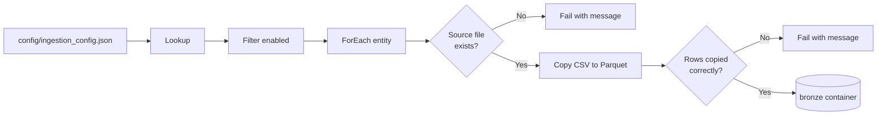

# Metadata-Driven Ingestion with Azure Data Factory

A mini project that loads multiple CSV files into a Bronze zone in **Azure Data Lake
Storage Gen2** as Parquet. A JSON control file decides what is loaded, so adding a
similar CSV dataset needs no pipeline change.

## Architecture



## Tech stack
Azure Data Factory, ADLS Gen2, managed identity, Bicep, Parquet, Python (pytest), GitHub Actions.

## Features
- Parent and child pipeline pattern driven by a control file
- Parameterised datasets and parallel processing (up to 3 entities)
- Missing-file check and copy row count check with clear error codes
- Retries on metadata, lookup and copy activities
- Date-partitioned output: a rerun with the same `runDate` writes the same file path
- Managed identity authentication with no stored keys
- Daily schedule trigger, stopped by default
- Azure resources defined in Bicep and static validation tests run in CI

## Pipelines
| Pipeline | Purpose |
|---|---|
| `pl_master_ingestion` | Reads the control file, filters it and calls the child for each entity |
| `pl_ingest_entity` | Checks, copies and verifies one entity |

## Output layout
```
bronze/<entity>/load_date=YYYY-MM-DD/<entity>.parquet
```
If `runDate` is empty, the UTC date of the run's trigger time is used.

## Project structure
```
├── adf/            # pipelines, datasets, linked service, trigger (ADF Git root)
├── config/         # control file
├── data/           # generator and sample CSV files
├── infra/          # Bicep template
├── tests/          # static validation
└── docs/SETUP_GUIDE.md
```

## Expected results
| Entity | Control file | Expected rows |
|---|---|---|
| customers | enabled | 50 |
| products | enabled | 20 |
| orders | enabled | 500 |
| returns | disabled | skipped |

## Tests
```bash
pip install -r requirements-dev.txt
pytest -v
```
The tests check JSON files, references, parameters, the control file and sample data.
They do not execute Azure pipelines.

## Limitations and future improvements
- Each run is a full file load. Next step: incremental loading with a watermark.
- The row check compares rows read and written by the copy. It does not validate values
  or column names. Next step: schema and business rule validation.
- Failures appear in ADF Monitor. Next step: alerts and an audit log.
- Next step: separate dev and production factories with automated deployment.

## Note
All data is synthetic. This is a learning and portfolio project.
